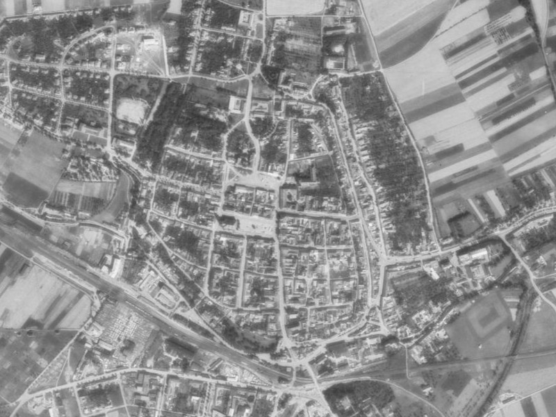

# Skutečný mapový výřez: Uherský Brod



**Historická ortofotomapa ©CENIA 2010 a ©GEODIS BRNO, spol. s r.o.** Licence [CC BY 4.0](https://creativecommons.org/licenses/by/4.0/). [Oznámení poskytovatele o licenci](https://cenia.gov.cz/2022/02/17/historicka-ortofotomapa-z-50-let-se-otevira/). Zde je reprodukován prostorový výřez přepočítaný serverem na 800 × 600 pixelů; obraz nebyl obsahově retušován.

Výřez byl skutečně stažen 2. listopadu 2026 klientem `wms-map`. Odpovídající [JSON metadata](assets/uhersky-brod-ortofoto.jpg.json) uchovávají celý požadavek, CRS, bounding box, rozměry a SHA256. Podkladový [definiční bod RÚIAN](assets/uhersky-brod-ruian.json) pochází z části obce Uherský Brod, kód 412643, v obci 592731. Je použit pouze k výběru demonstračního výřezu, nikoli jako historická poloha konkrétní stavby.

## Reprodukce

Z kořene repozitáře:

```bash
python3 skills/pamet-krajiny/scripts/zdroje.py wms --url https://gis.cenia.cz/mapcache/ortofotomapa_historicka/wms
python3 skills/pamet-krajiny/scripts/zdroje.py wms-map --url https://gis.cenia.cz/mapcache/ortofotomapa_historicka/wms --layer orto --crs EPSG:5514 --version 1.1.1 --bbox=-525389,-1187795,-523789,-1186595 --width 800 --height 600 --out work/uhersky-brod-ortofoto.jpg
```

Vstupní bbox zde používá nativní souřadnice S-JTSK / Krovak East North (EPSG:5514) v metrech, pořadí easting,northing. Příkaz nepřevádí zeměpisnou délku a šířku do tohoto systému. Pro jinou obec nejprve získej správně identifikované souřadnice v odpovídajícím CRS a zvol nový bbox. V kódu není pevné nastavení na Uherský Brod.

## Co příklad nedokazuje

Vrstva se jmenuje „50. léta“, ale zahrnuje i snímky z jiných období. **Konkrétní rok snímku v tomto výřezu zatím nebyl ověřen** ve vrstvě roků snímkování. Výřez sám nedokazuje stáří domů, zánik cesty ani identitu severního parku z textového příkladu. Není použit k automatickému doplnění souřadnic do historického dossieru.

Při živém ověření server na požadavek PNG odpověděl JPEG. Klient nesoulad odmítl a soubor neuložil. Následující výslovný požadavek JPEG uspěl; proto příklad používá `.jpg`. HTTP chyby 401/403/429/503 se automaticky neopakují.
